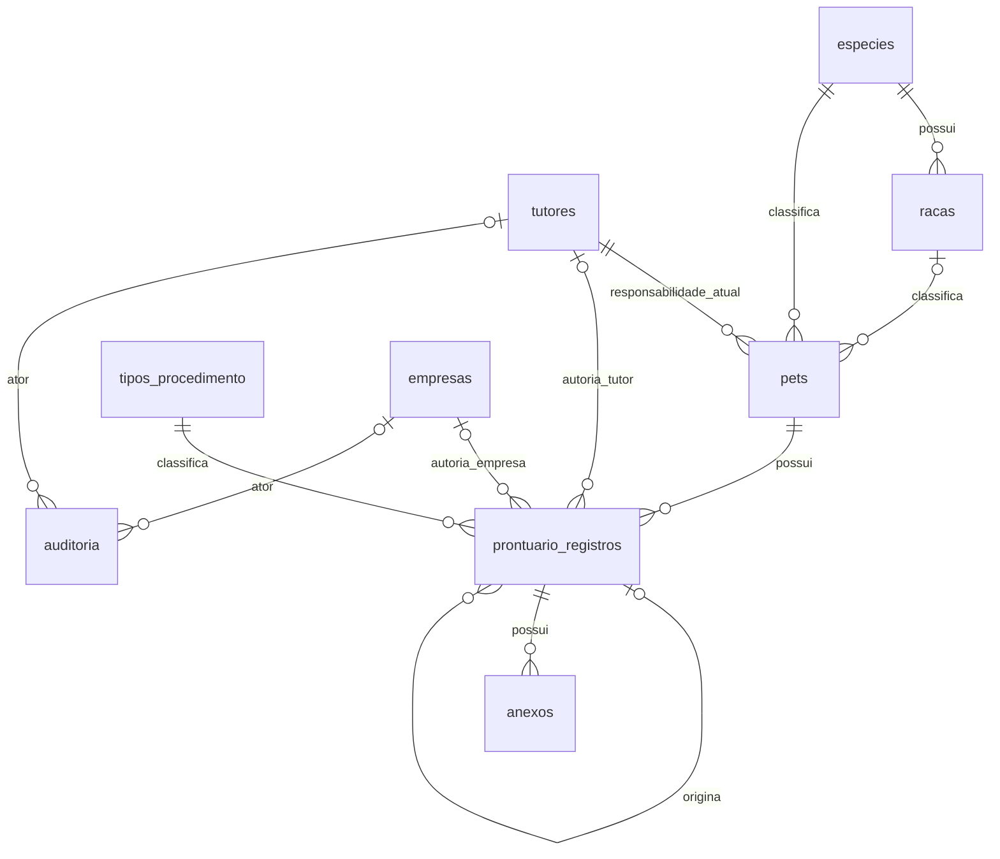

# Modelo de dados da Fase 1

## Dicionário de domínio

O [DDL PostgreSQL](../database/schema/pet-domain.sql) é a referência de tipo, tamanho, nulabilidade e restrições de cada campo. UUIDs identificam as entidades centrais. Catálogos e auditoria usam identidade BIGINT. Datas civis usam DATE, e instantes usam TIMESTAMPTZ. Endereço e identificadores fiscais são strings.

| Tabela | Campos e invariantes |
|---|---|
| `tutores` | `id_tutor`, nome, CPF opcional, e-mail normalizado, verificação, senha em hash e `google_sub` opcional. Dados pessoais, contato, endereço, foto e estado da conta na mesma linha. CPF e e-mail são únicos. |
| `especies` | `id_especie`, nome único, nome científico e situação no catálogo. |
| `racas` | `id_raca`, espécie, nome e situação. Nome único por espécie. Uma raça informada em `pets` precisa pertencer à espécie cadastrada. |
| `pets` | `id_pet`, vínculo obrigatório com tutor, `cpf_pet` único e imutável, espécie, raça opcional, identificação física e clínica. Microchip informado é único. Sexo desconhecido é nulo. Idade é calculada. `versao_tutoria` invalida convites anteriores. |
| `tipos_procedimento` | `id_tipo_procedimento`, nome, descrição, categoria, situação e possibilidade de agendamento. |
| `prontuario_registros` | `id_registro`, pet, tipo, título, descrição, observações, datas de agenda e realização, status, origem, autoria, profissional e observações estruturadas em JSONB. A origem de um retorno ou reforço precisa ser outro registro do mesmo pet. |
| `anexos` | `id_anexo`, registro, nomes de arquivo, caminho privado, MIME, tamanho, SHA-256, descrição, classificação e exclusão lógica. O arquivo fica no storage. |
| `empresas` | `id_empresa`, razão social, CNPJ único, contato, endereço, responsável, identificador da credencial, hash do segredo, atividade e permissão. Uma credencial por empresa. |
| `auditoria` | `id_auditoria`, entidade, ID, ação, ator, origem, dados anteriores e novos, contexto HTTP e data. O registro seleciona os campos auditados. Senhas, tokens e bytes de anexos ficam fora da trilha. |

## Regras aplicadas

- `cpf_pet` usa 12 símbolos aleatórios de Base32 Crockford. Os dois dígitos correspondem a 98 menos o resto de multiplicar por 100 o valor da sequência interpretado em base 32, módulo 97. A criação usa o índice único como garantia de concorrência.
- O registro nasce `AGENDADO` ou `REALIZADO`. Um agendamento pode ser concluído, cancelado ou marcado `NAO_REALIZADO`. Somente `REALIZADO` tem data de realização. O fim opcional fica depois do início. Instantes da API incluem fuso e a saída é UTC.
- O tutor responsável corrige somente registros escritos por ele. A empresa com permissão de escrita corrige seus próprios registros e informa motivo. A cada correção, preservam-se autoria e versões na auditoria. Itens clínicos realizados não têm rota de exclusão. Anexos comuns do tutor admitem exclusão lógica.
- A confirmação de transferência exige conta autenticada, e-mail verificado e assinatura temporária. O bloqueio do pet em transação serializa a troca e invalida os outros convites pela versão. A autoria e os anexos dos registros anteriores ficam vinculados ao pet.
- A validação de `dados_adicionais` aceita chaves por tipo. Vacinas/reforços aceitam nome, fabricante, lote e dose. Exames aceitam nome e resumo do resultado. Pesagem aceita peso em quilogramas. Os demais tipos usam os campos comuns.

## Tabelas técnicas

`migrations`, `personal_access_tokens`, `password_reset_tokens`, `sessions`, `cache`, `cache_locks` e `integration_requests`. Esta última coordena idempotência por empresa e chave e vincula o resultado ao procedimento ou anexo. A configuração padrão usa fila síncrona.
